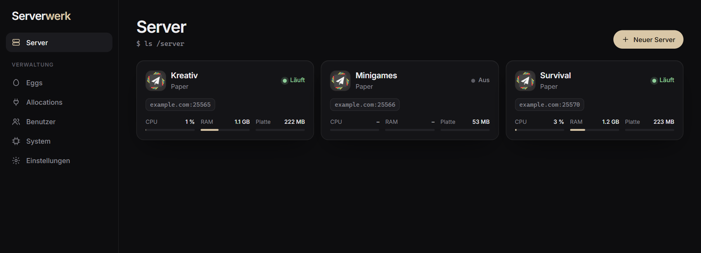
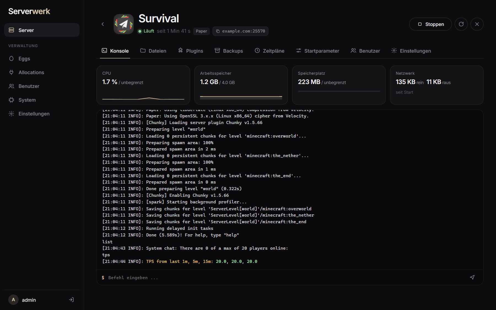
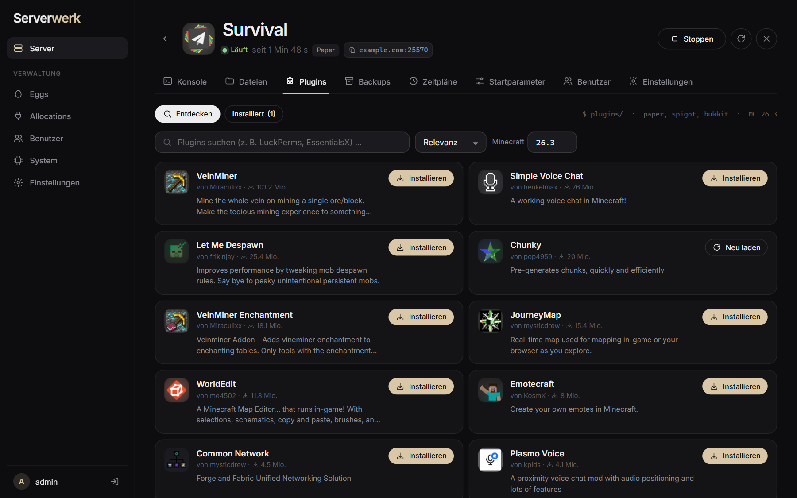
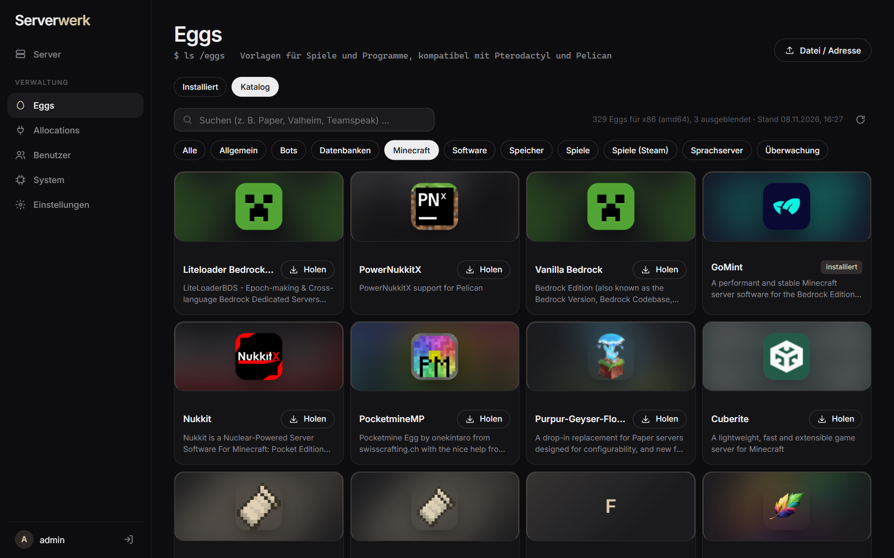
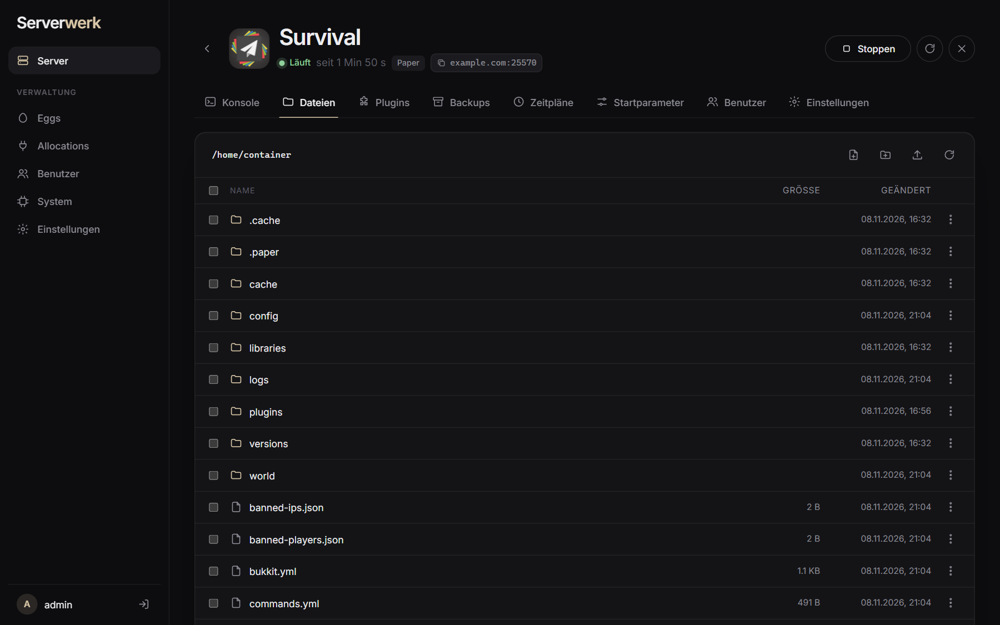
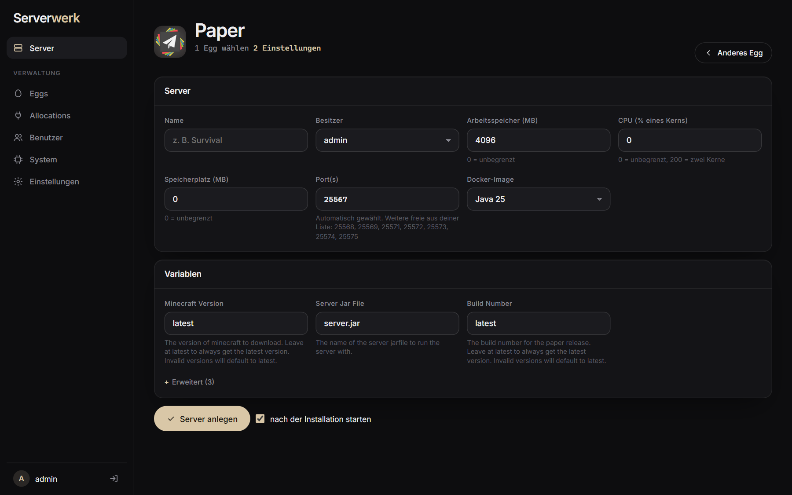
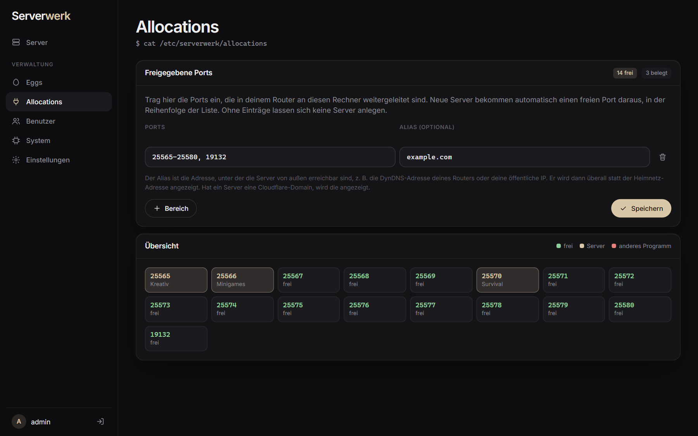
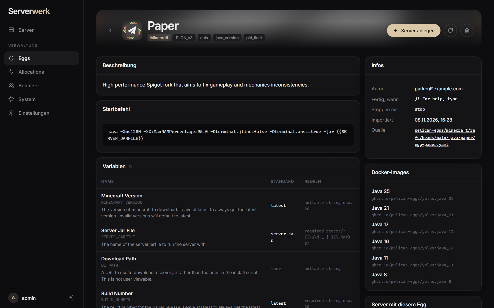
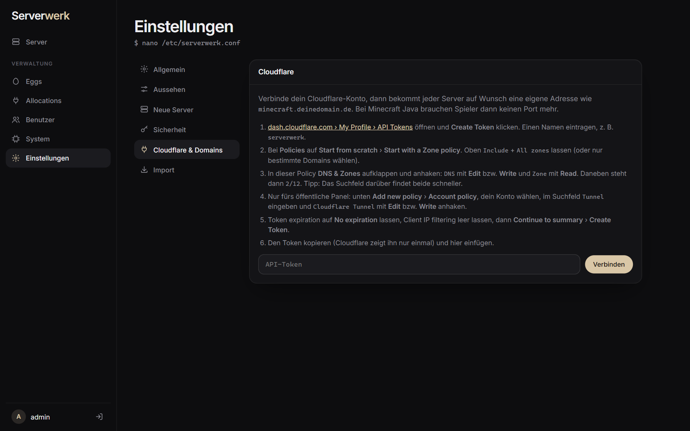
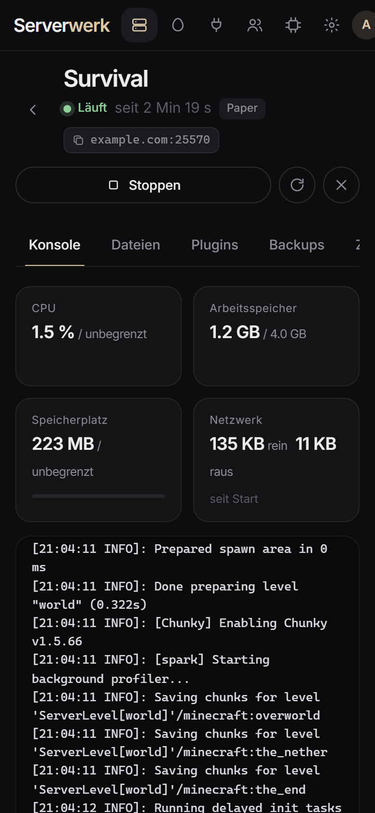

<div align="center">

# Serverwerk

**Ein schlankes Panel für Spielserver – moderner Ersatz für Pterodactyl.**
Ein einziges Programm statt Panel + Wings + PHP + MySQL + Redis + Nginx, installiert mit **einem Befehl**.

[English](README.md) · Deutsch



</div>

```sh
curl -fsSL https://github.com/moppel30/serverwerk/releases/latest/download/install.sh | sudo sh
```

Der Installer fragt nach der Sprache (Standard: Englisch, `2` für Deutsch) und prüft, welche Ports
für die Weboberfläche frei sind. Am Ende gibt er einen Link aus, über den du dein eigenes
Admin-Konto anlegst. Der Link enthält einen einmaligen Einrichtungs-Code, damit niemand anderes im
Netz zuvorkommt.

## Was es kann

- **Alle Pterodactyl- und Pelican-Eggs**: PTDL_v1, PTDL_v2 und das neue Pelican-Format
  (JSON und YAML). Eingebauter Katalog mit über 300 Community-Eggs (Minecraft, Steam-Spiele,
  Sprachserver, Bots, Datenbanken …), Holen mit einem Klick, mit Logos.
- **Nur was passt**: Auf ARM-Rechnern (z. B. Raspberry Pi) werden Eggs ausgeblendet,
  deren Docker-Images es nur für x86 gibt, und umgekehrt.
- **Konsole live** mit Farben, CPU-, RAM-, Platten- und Netzwerk-Werte.
- **Dateimanager** mit Editor, Hochladen per Ziehen (auch ganze Ordner), Zip/Tar entpacken.
- **Plugins und Mods** für Minecraft direkt im Panel suchen und installieren (Modrinth):
  Paper/Spigot/Purpur-Plugins, Fabric/Forge/NeoForge-Mods, Velocity/BungeeCord, Datapacks.
- **Backups**, **Zeitpläne** (Cron), **Unterbenutzer** mit Rechten.
- **Allocations**: Portbereiche festlegen, neue Server bekommen automatisch einen freien Port,
  optional mit Alias (z. B. die DynDNS-Adresse des Routers).
- **Cloudflare**: eigene Adressen wie `minecraft.example.com` pro Server (bei Minecraft Java
  mit SRV-Eintrag, also ohne Port), auf Wunsch automatisch für jeden Server (z. B.
  `survival.panel.example.com`), automatische Anpassung bei neuer öffentlicher IP,
  und das Panel selbst per Cloudflare Tunnel öffentlich machen (HTTPS, ohne Portfreigabe).
- **Import aus Pterodactyl**: Server mit Ports, Grenzen, Variablen, Egg und allen Dateien
  übernehmen. Klappt auch, wenn Pterodactyl in einer VM auf demselben Rechner läuft.
- **Sauberes Herunterfahren**: Fährt der Rechner herunter, werden alle Server mit ihrem
  eigenen Stopp-Befehl gespeichert und beendet. Nach dem Hochfahren starten sie wieder.
  Ein Update des Panels lässt laufende Server in Ruhe.
- **Deutsch und Englisch**, dunkles und helles Design, Akzentfarbe frei wählbar, läuft auch auf dem Handy.
- **Drei Stile**: Serverwerk oder im Stil von Pterodactyl oder Pelican, damit beim Umstieg alles vertraut aussieht. Nur das Aussehen ändert sich.

## Screenshots

| | |
|---|---|
|  |  |
| **Konsole** mit Live-Werten | **Plugins und Mods** von Modrinth |
|  |  |
| **Egg-Katalog** mit über 300 Vorlagen | **Dateimanager** |
|  |  |
| **Neuer Server** | **Allocations** (Ports) |
|  |  |
| **Egg-Details** | **Einstellungen** (Cloudflare) |

<p align="center"></p>

## Voraussetzungen

- Linux mit x86_64 (amd64) oder ARM64 (z. B. Raspberry Pi 4/5 mit 64-Bit-System)
- Unterstützt: Debian, Ubuntu, Linux Mint, Raspberry Pi OS, Fedora, RHEL/Rocky/Alma, CentOS,
  Arch/Manjaro, openSUSE, Alpine, Void
- Docker wird bei Bedarf automatisch installiert.

## Installieren, aktualisieren, entfernen

| Was | Befehl |
|---|---|
| Installieren | `curl -fsSL https://github.com/moppel30/serverwerk/releases/latest/download/install.sh \| sudo sh` |
| Aktualisieren | denselben Befehl erneut ausführen, Server und Daten bleiben erhalten |
| Ohne Nachfragen | `curl -fsSL …/install.sh \| sudo sh -s -- --lang de --port 8200` |
| Entfernen | `curl -fsSL …/install.sh \| sudo sh -s -- --uninstall` (Daten bleiben in `/var/lib/serverwerk`) |
| Passwort vergessen | `sudo serverwerk passwort admin` |

## Erste Schritte

1. Den Link vom Ende der Installation öffnen und das Admin-Konto anlegen.
2. Unter **Allocations** die Ports eintragen, die im Router freigegeben sind, z. B. `25565-25575`.
3. Unter **Eggs › Katalog** ein Spiel holen, z. B. Paper für Minecraft.
4. **Neuer Server** – Egg wählen, Namen eingeben, fertig. Die Installation läuft in der Konsole mit.

Die Sprache lässt sich jederzeit unter **Einstellungen › Allgemein** ändern.

## Aufbau

| Pfad | Inhalt |
|---|---|
| `panel/` | Go-Code (Panel und Server-Verwaltung in einem), Weboberfläche in `panel/web/` (eingebettet) |
| `panel/web/i18n/en.json` | englische Übersetzungen (der Code ist auf Deutsch geschrieben) |
| `install.sh` | Installer für alle unterstützten Distributionen |
| `build.sh` | baut `dist/serverwerk-linux-amd64` und `-arm64` |
| `tools/extract_strings.py` | listet Texte, die in der Übersetzung fehlen |
| `test/` | Hilfen für Tests (nachgebaute Pterodactyl-API, nachgebaute macvtap-VM) |

Daten auf dem Server: `/var/lib/serverwerk` (Zustand, Server-Dateien, Backups).
Spielserver laufen als Container `serverwerk-<id>` mit Benutzer 988, wie bei Pterodactyl.

## Selbst bauen

```sh
sh build.sh          # braucht Go
cd panel && go test ./...
```

Eine neue Version wird veröffentlicht, indem man die Versionsnummer in `panel/main.go` anpasst
und einen Tag setzt (`git tag v1.0.0 && git push --tags`). GitHub Actions baut dann die
Programme und hängt sie zusammen mit `install.sh` an das Release.

## Sicherheit

- Das Panel läuft als root, weil es Docker steuert und Dateien der Server verwaltet.
- Ohne Cloudflare Tunnel ist es nur im eigenen Netz erreichbar. Wer es öffentlich macht,
  sollte starke Passwörter nutzen; nach mehreren Fehlversuchen wird eine Adresse vorübergehend
  gesperrt (einstellbar unter Einstellungen › Sicherheit).

## Lizenz

MIT, siehe [LICENSE](LICENSE).
