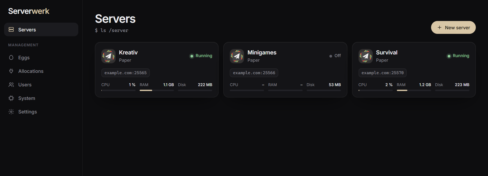
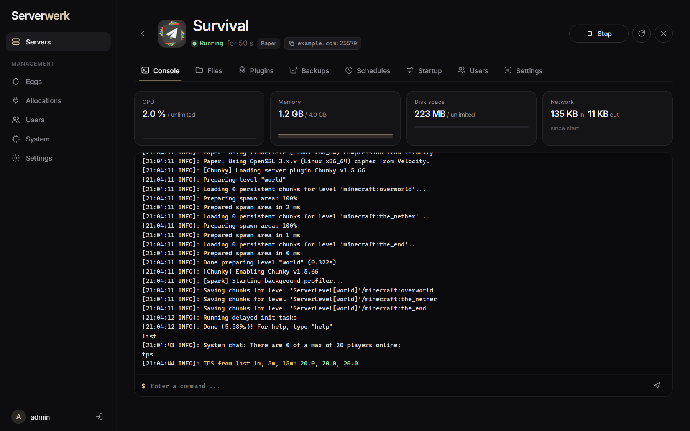
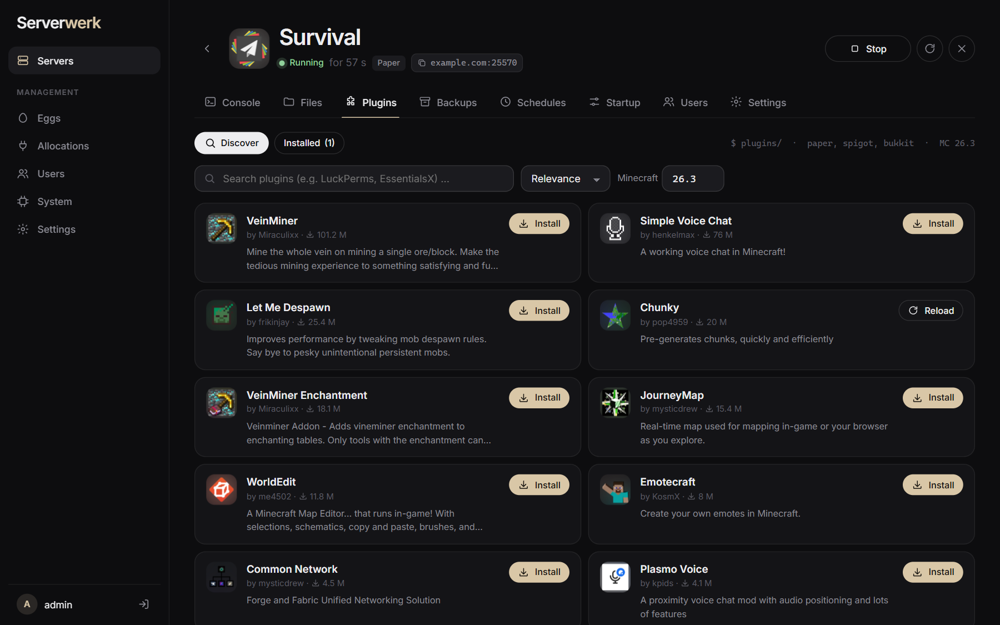
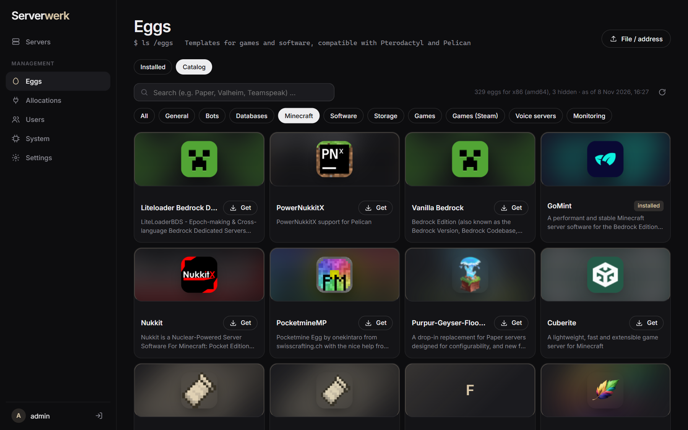
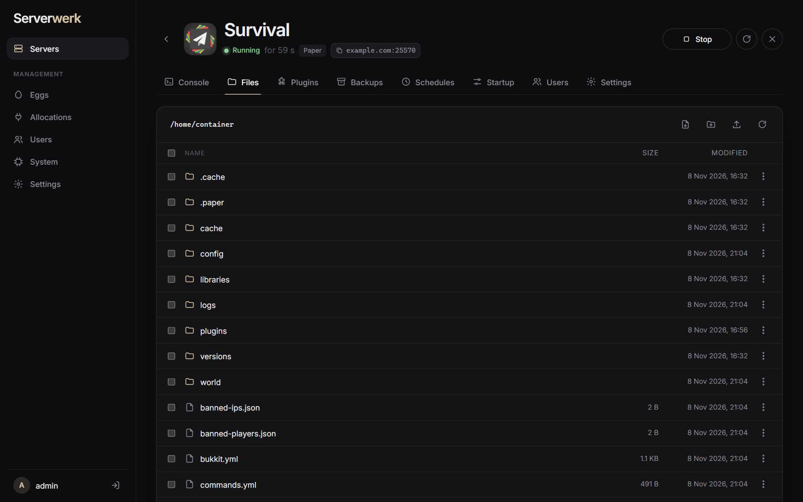
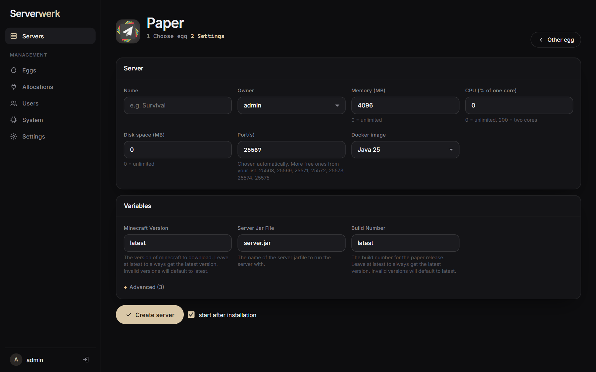
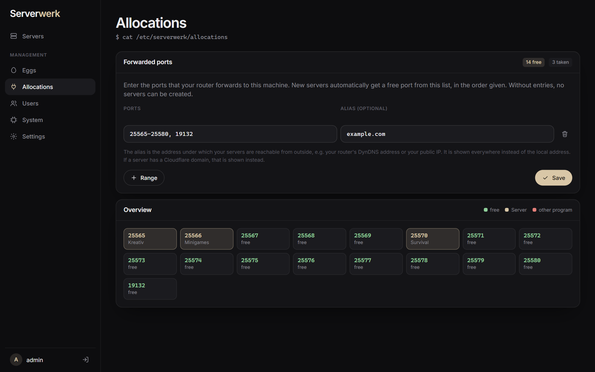
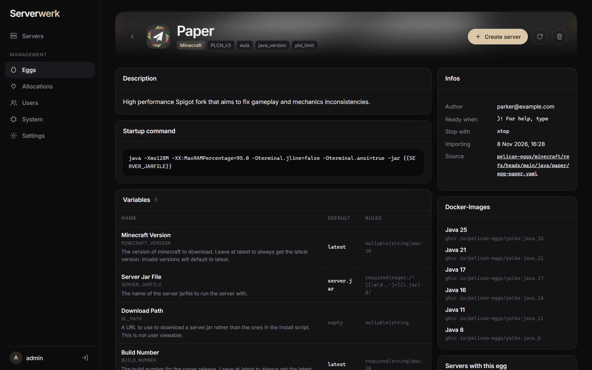
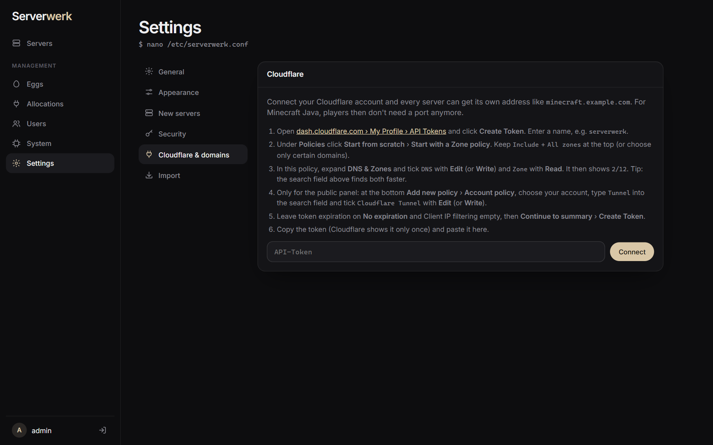
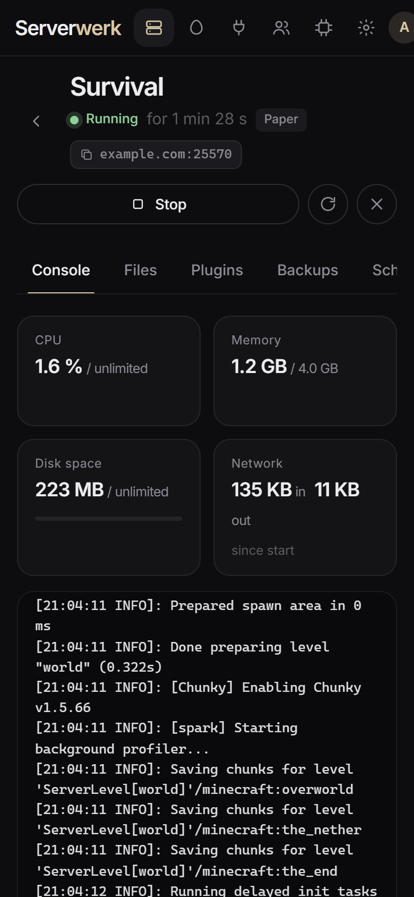

<div align="center">

# Serverwerk

**A lean game server panel – a modern replacement for Pterodactyl.**
One program instead of panel + Wings + PHP + MySQL + Redis + Nginx, installed with **a single command**.

English · [Deutsch](README.de.md)



</div>

```sh
curl -fsSL https://github.com/moppel30/serverwerk/releases/latest/download/install.sh | sudo sh
```

The installer asks for the language (English by default) and checks which ports are free for the
web interface. At the end it prints a link where you create your own admin account. The link
contains a one-time setup code, so nobody else on your network can get there first.

## Features

- **All Pterodactyl and Pelican eggs**: PTDL_v1, PTDL_v2 and the new Pelican format (JSON and YAML).
  Built-in catalog with 300+ community eggs (Minecraft, Steam games, voice servers, bots,
  databases …), one click to install, with logos.
- **Only what fits**: on ARM machines (e.g. Raspberry Pi) eggs whose Docker images only exist for
  x86 are hidden, and vice versa.
- **Live console** with colors, CPU, memory, disk and network stats.
- **File manager** with editor, drag & drop upload (whole folders too), zip/tar extraction.
- **Plugins and mods** for Minecraft, browsed and installed right inside the panel (Modrinth):
  Paper/Spigot/Purpur plugins, Fabric/Forge/NeoForge mods, Velocity/BungeeCord, datapacks.
- **Backups**, **schedules** (cron), **sub-users** with permissions.
- **Allocations**: define port ranges, new servers get a free port automatically, optionally with
  an alias (e.g. your router's DynDNS address).
- **Cloudflare**: own addresses like `minecraft.example.com` per server (with an SRV record for
  Minecraft Java, so no port needed), optionally automatic for every server (e.g.
  `survival.panel.example.com`), automatic update when your public IP changes, and make the
  panel itself public via Cloudflare Tunnel (HTTPS, no port forwarding).
- **Import from Pterodactyl**: take over servers with ports, limits, variables, egg and all files.
  Also works when Pterodactyl runs in a VM on the same machine.
- **Clean shutdown**: when the machine shuts down, all servers are saved and stopped with their own
  stop command, and they start again after boot. Updating the panel leaves running servers alone.
- **English and German**, dark and light theme, free accent color, works on phones.

## Screenshots

| | |
|---|---|
|  |  |
| **Console** with live stats | **Plugins and mods** from Modrinth |
|  |  |
| **Egg catalog** with 300+ templates | **File manager** |
|  |  |
| **New server** | **Allocations** (ports) |
|  |  |
| **Egg details** | **Settings** (Cloudflare) |

<p align="center"></p>

## Requirements

- Linux on x86_64 (amd64) or ARM64 (e.g. Raspberry Pi 4/5 with a 64-bit OS)
- Supported: Debian, Ubuntu, Linux Mint, Raspberry Pi OS, Fedora, RHEL/Rocky/Alma, CentOS,
  Arch/Manjaro, openSUSE, Alpine, Void
- Docker is installed automatically if needed.

## Install, update, remove

| What | Command |
|---|---|
| Install | `curl -fsSL https://github.com/moppel30/serverwerk/releases/latest/download/install.sh \| sudo sh` |
| Update | run the same command again, servers and data are kept |
| Without questions | `curl -fsSL …/install.sh \| sudo sh -s -- --lang en --port 8200` |
| Remove | `curl -fsSL …/install.sh \| sudo sh -s -- --uninstall` (data stays in `/var/lib/serverwerk`) |
| Forgot password | `sudo serverwerk password admin` |

## First steps

1. Open the link from the end of the installation and create your admin account.
2. Under **Allocations**, enter the ports forwarded in your router, e.g. `25565-25575`.
3. Under **Eggs › Catalog**, get a game, e.g. Paper for Minecraft.
4. **New server** – choose the egg, enter a name, done. The installation runs live in the console.

The language can be changed anytime under **Settings › General**.

## Structure

| Path | Content |
|---|---|
| `panel/` | Go code (panel and server management in one), web interface in `panel/web/` (embedded) |
| `panel/web/i18n/en.json` | English translations (the code is written in German) |
| `install.sh` | Installer for all supported distributions |
| `build.sh` | builds `dist/serverwerk-linux-amd64` and `-arm64` |
| `tools/extract_strings.py` | lists texts that are missing in the translation |
| `test/` | test helpers (fake Pterodactyl API, simulated macvtap VM) |

Data on the server: `/var/lib/serverwerk` (state, server files, backups).
Game servers run as container `serverwerk-<id>` with user 988, like Pterodactyl.

## Building

```sh
sh build.sh          # needs Go
cd panel && go test ./...
```

A new version is released by updating the version number in `panel/main.go` and pushing a tag
(`git tag v1.0.0 && git push --tags`). GitHub Actions then builds the programs and attaches them
to the release together with `install.sh`.

## Security

- The panel runs as root because it controls Docker and manages the servers' files.
- Without a Cloudflare Tunnel it is only reachable in your own network. If you make it public, use
  strong passwords; after several failed attempts an address is temporarily blocked
  (configurable under Settings › Security).

## License

MIT, see [LICENSE](LICENSE).
